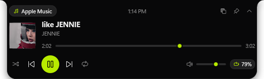

# Windows Live — Dynamic Island Dock for Windows 11

A native, lightweight Dynamic Island style dock anchored at the top of your screen, designed with authentic **WinUI 3 & Fluent System Icon** styling, real-time Windows media integration, dynamic theme adaptation, and smart full-screen/maximized app detection.




---

## Features

- **Dynamic Island Silhouette & Geometry**:
  - Matches top notch hardware/bezel style with concave ear fillets curving into the screen edge.
  - Smooth rounded bottom corners and dynamic OLED dark / frosted light backgrounds with a 1px WinUI 3 Fluent border.
  - Seamless toggle between **Attached Top Notch** and **Floating Capsule Pill** modes.

- **Intelligent Window State Detection**:
  - **Full-Screen Apps (Games, Fullscreen Video, Presentations)**: The dock hides completely (`Visibility="Collapsed"`) so it never obstructs immersion or controls.
  - **Maximized Apps (Browser, Office, IDE)**: The dock auto-hides so titles, tabs, and top toolbars remain clean and unobstructed. Moving the cursor to the top-center edge smoothly reveals the dynamic island. Leaving the dock smoothly auto-hides it back.
  - **Normal / Desktop State**: Visible by default at the top of your screen.

- **Device Theme & Accent Color Synchronization**:
  - Follows Windows Light / Dark mode in real time.
  - Applies your system accent color to the scrubber, circular progress ring, equalizer bars, Play button, and active badges.

- **WinUI 3 & Fluent System Icons**:
  - Official Fluent System Icons: `Play24`, `Pause24`, `Previous24`, `Next24`, `Speaker224`, `SpeakerMute24`, `BatteryCharge24`, `Pin24`, `ChevronUp24`, `MusicNote224`.
  - WinUI 3 typography (Segoe UI Variable), subtle hover highlights, and fluid cubic ease animations.

- **Dual-State Dynamic Morphing**:
  - **Compact State (Idle)**:
    - Left: Rotating circular album art / media disc surrounded by a circular progress arc in system accent color.
    - Center: Live track title and artist ticker.
    - Right: Dynamic 5-bar animated audio equalizer responding to playback.
  - **Expanded State (Interactive Card)**:
    - Smooth expansion animation on hover or click.
    - Full high-resolution album artwork thumbnail with rounded corners and drop shadow.
    - Interactive seek slider with live elapsed and remaining timestamps.
    - Media controls: Shuffle, Previous, Play/Pause accent button, Next, Repeat.
    - Real Windows master volume control slider and mute toggle.
    - Real-time battery indicator with percentage and charging status.
    - Quick actions: Dock style switch (Notch vs Floating Pill), Pin expanded state, and Collapse.

- **Real-Time Windows Integration**:
  - Uses `Windows.Media.Control.GlobalSystemMediaTransportControlsSessionManager` (WinRT) to listen to Spotify, Apple Music, YouTube in Chrome/Edge, Windows Media Player, etc.
  - Native volume control via Windows CoreAudio `IAudioEndpointVolume`.
  - Battery percentage & status via Windows `PowerManager`.
  - Native `WM_NCHITTEST` click-through: only the island surface receives clicks, while transparent surrounding areas pass clicks directly to underlying applications and windows.

---

## How to Run

### Quick Start
Double-click `launch.bat` in the project directory, or run from PowerShell / Terminal:

```powershell
cd windows_live
dotnet run
```

### Pre-requisites
- Windows 10 (Build 19041+) or Windows 11
- .NET 8.0 or .NET 10.0 SDK
